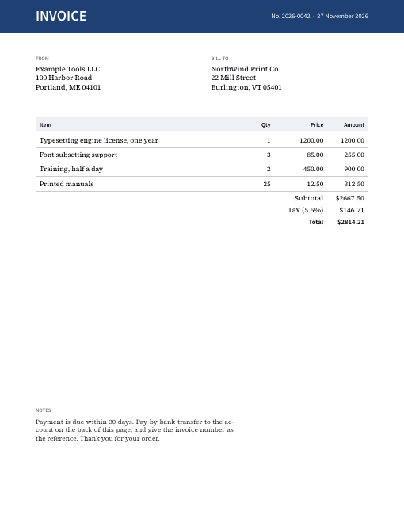
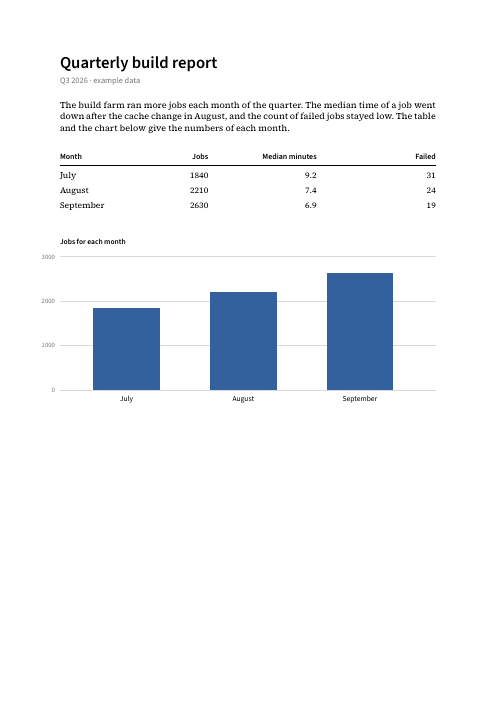
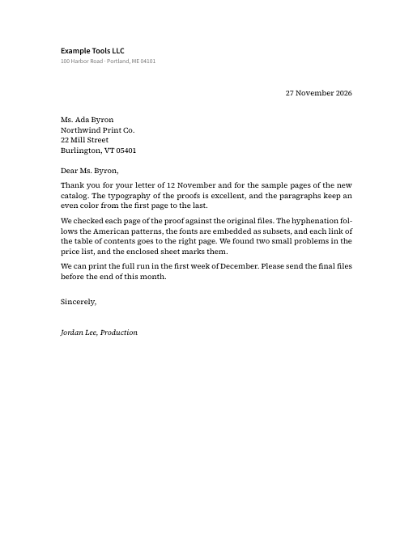
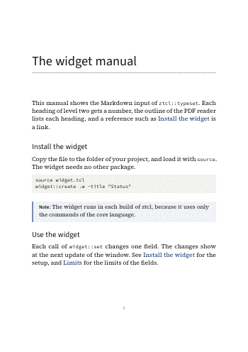
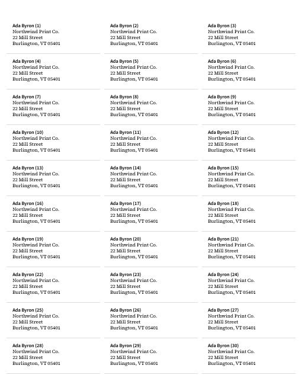

# PDF documents

`ztcl::pdf` writes PDF files from Tcl with no other program and no library: text in your own fonts, tables, charts, images, links, and bookmarks. This guide has five complete programs in `examples/pdf/`. Run each one from the top folder of ztcl; the script reads the fonts of `book/fonts/` and writes one PDF file:

```sh
$ ztcl --allow channels,file --tclsh examples/pdf/invoice.tcl invoice.pdf
wrote invoice.pdf, 1 pages
```

The flags turn on the files. `ztcl::pdf` itself reads and writes no file, so a script in the sandbox can make a PDF in memory and give its bytes to the embedder. [ztcl::pdf](modules/pdf.md) is the reference of each command, and [Typesetting in Tcl](typesetting.md) explains the paragraphs.

> [!NOTE]
> `ztcl::pdf` is on `main` and comes in the next release. [Build from source](install.md#build-from-source) to use it now.

## The model

A document has pages, and each command draws on one page in points (1/72 inch) from the lower-left corner. A text position is the left end of the baseline. The program measures text with `ztcl::pdf measure` to align it right or center it, and breaks paragraphs with `ztcl::typeset break`. `examples/pdf/common.tcl` has the helpers of the examples: `slurp` reads a file, `loadFonts` adds the fonts of the book, `rightText` aligns text right, and `save` writes the file.

```tcl
set doc [ztcl::pdf create]
set serif [ztcl::pdf font $doc [slurp book/fonts/SourceSerif4-Regular.ttf]]
set page [ztcl::pdf page $doc 612 792]                 ;# US Letter
ztcl::pdf text $doc $page $serif 11 72 720 "Hello"
set w [ztcl::pdf measure $doc $serif 11 "Total: \$42.00"]
ztcl::pdf text $doc $page $serif 11 [expr {540 - $w}] 720 "Total: \$42.00"
```

Here is the model as a whole program. In this page it runs in the browser, with the fonts of the site, and the PDF shows under it:

<!-- run -->
```tcl
package require ztcl::pdf
set f [open book/fonts/SourceSerif4-Regular.ttf rb]
set data [read $f]
close $f
set doc [ztcl::pdf create]
set serif [ztcl::pdf font $doc $data]
set page [ztcl::pdf page $doc 612 792]
ztcl::pdf text $doc $page $serif 24 72 720 "Hello from ztcl::pdf"
set total "Total: \$42.00"
set w [ztcl::pdf measure $doc $serif 11 $total]
ztcl::pdf text $doc $page $serif 11 [expr {540 - $w}] 690 $total
set out [open hello.pdf wb]
puts -nonewline $out [ztcl::pdf bytes $doc]
close $out
puts "hello.pdf: [ztcl::pdf pages $doc] page"
```

```text
hello.pdf: 1 page
```

## An invoice

`examples/pdf/invoice.tcl` has a colored header, two address blocks, a table of items with right-aligned numbers and rules, the totals, and a justified note at the bottom.



The table is a loop over the items. Each amount is right-aligned at the edge of its column:

```tcl
foreach {name qty price} $items {
    set amount [expr {$qty * $price}]
    ztcl::pdf text $doc $p $serif 10 60 $y $name
    rightText $doc $p $serif 10 552 $y [format %.2f $amount]
    ztcl::pdf line $doc $p 54 [expr {$y - 7}] 558 [expr {$y - 7}] -width 0.4 -color {0.8 0.8 0.8}
    set y [expr {$y - 22}]
}
```

## A report with a table and a chart

`examples/pdf/report.tcl` has a title, a justified paragraph, a table, and a bar chart with a grid and labels. The chart is rectangles and lines: each bar has the height of its value on the scale of the axis.



```tcl
foreach {month jobs} $data {
    set bh [expr {$h * $jobs / double($max)}]
    ztcl::pdf rect $doc $p $bx $base 80 $bh -fill {0.2 0.38 0.62}
    incr bx 140
}
```

A chart from a ztk canvas can go into a PDF the same way: read the coordinates of each canvas item and draw it with `rect` and `line`. A direct export of a canvas to PDF is not in this version.

## A letter with an embedded font

`examples/pdf/letter.tcl` uses one family, Source Serif 4, in two styles. The PDF has a subset of each style, so the letter looks the same on each computer, also one with no copy of the font. The paragraphs are justified and hyphenated by `ztcl::typeset break`.



## A manual with an outline and links

`examples/pdf/manual.tcl` gives Markdown to `ztcl::typeset markdown`, with a page size of A5. The result has an opening heading, numbered sections, a code block, a note, links between the sections, an outline that a PDF reader shows as bookmarks, running heads, page numbers, and an index from the `{^term}` marks of the text.



```tcl
set stats [ztcl::typeset markdown $doc $text -fonts $fonts \
    -style {page_w 420 page_h 595 inner 54 outer 54 top 70 lines 32}]
```

For your own links and bookmarks, without Markdown, use the commands directly:

```tcl
ztcl::pdf dest $doc limits $page 72 700                ;# a named place
ztcl::pdf link $doc $p2 72 500 200 512 -dest limits    ;# a link to it
ztcl::pdf link $doc $p2 72 480 200 492 -uri https://beetlebug.org/ztcl/
ztcl::pdf outline $doc "Limits" 1 $page 700           ;# a bookmark
```

## A sheet of labels

`examples/pdf/labels.tcl` prints 30 address labels on a US Letter sheet: 3 columns and 10 rows of 1 by 2-5/8 inch labels. A thin line marks the bottom of each label, to check the alignment on a test print before a print on the label stock.



## Check a file

`tools/pdf-check.py` checks the structure of a PDF file from `ztcl::pdf`: the cross-reference table, each stream, the page tree, and each embedded font. It also runs `qpdf --check` when `qpdf` is on the `PATH`. CI runs it on each example and on the book.

```sh
$ python3 -I tools/pdf-check.py invoice.pdf
```
