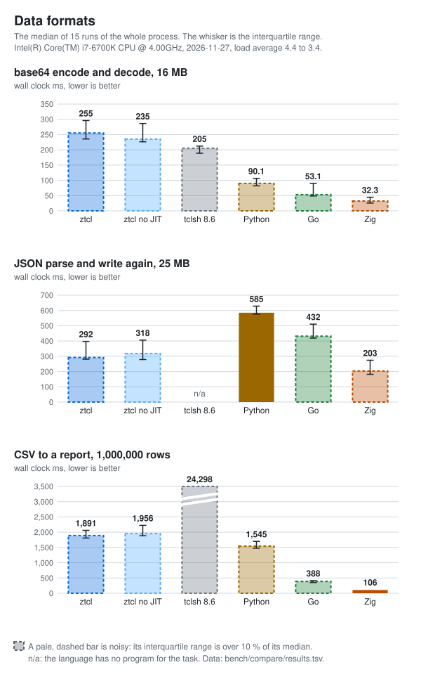
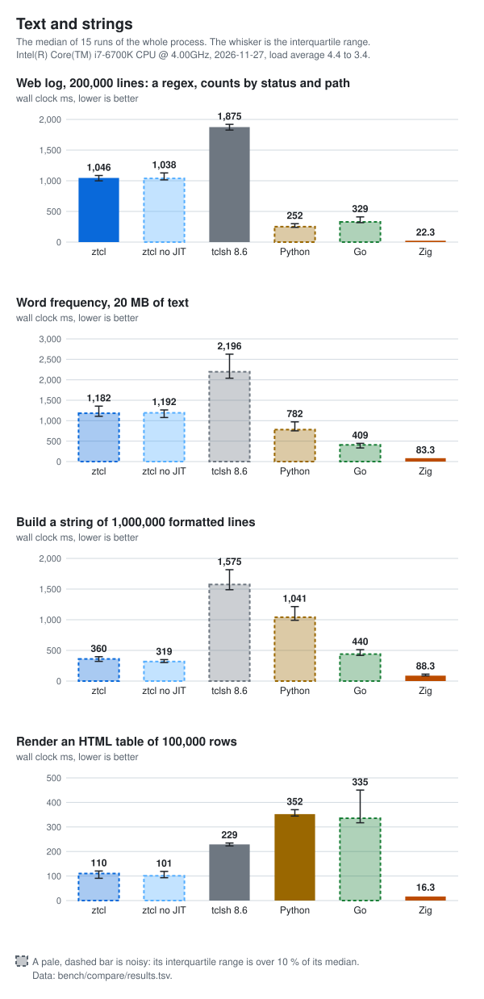
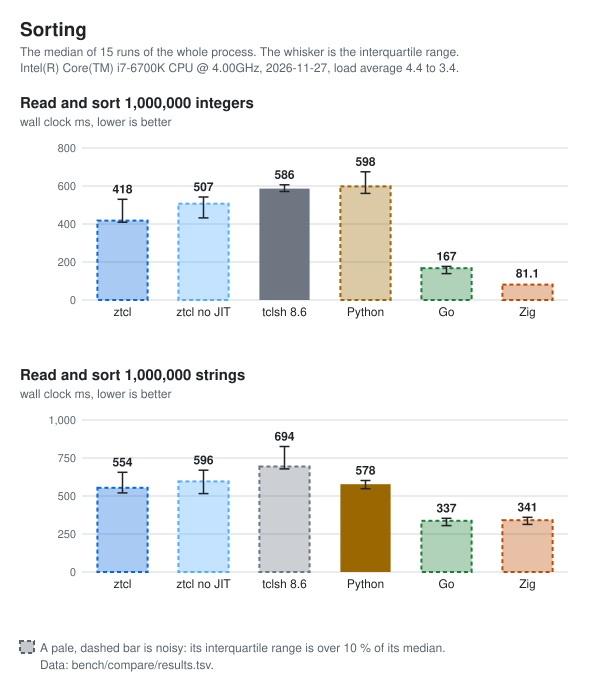
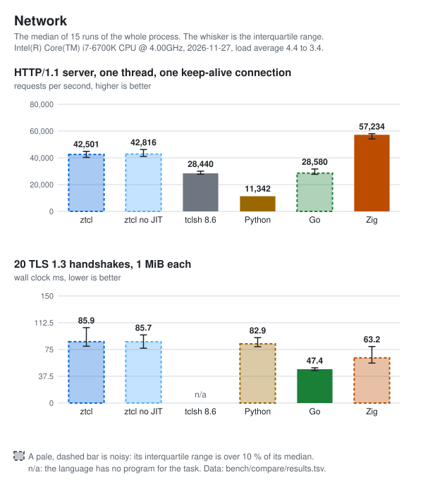
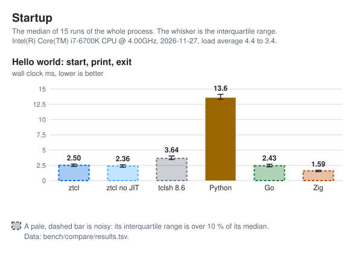
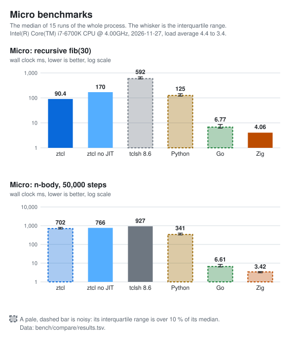

# Performance

## Against Tcl, Python, Go, and Zig

[bench/compare](../bench/compare/README.md) runs the same 14 tasks in ztcl, tclsh 8.6.16, Python 3.14, Go 1.26, and Zig 0.17.0. Each program is the code that a fluent user of the language writes with the standard library, and the outputs are equal byte for byte. Each time is the wall clock of the whole process in milliseconds, the median of 15 runs, so it includes the start of the runtime. The HTTP task gives requests for each second on one thread and one keep-alive connection. ztcl runs in its default mode, Tcl 9.1.

The host: an Intel Core i7-6700K (4 cores, 8 threads) with Linux 7.2, on 2026-11-27. Other jobs shared the host, with a load average of 4 to 7, so some values have a wide spread. The charts (`docs/site/bench/`, light and dark) show the interquartile range and mark each value with a spread over 10 % of its median. `results.tsv` has the quartiles and the extremes. A run on an Apple M1 comes next, as a second data set.

```sh
zig build -Doptimize=ReleaseFast
python3 -I bench/compare/run.py
python3 -I bench/compare/chart.py
```

| Task | ztcl | ztcl `--no-jit` | tclsh 8.6.16 | Python 3.14 | Go 1.26 | Zig 0.17 |
|---|---:|---:|---:|---:|---:|---:|
| base64, 16 MiB | 255 | 235 | 205 | 90.1 | 53.1 | 32.3 |
| JSON, 25 MB | 292 | 318 | n/a | 585 | 432 | 203 |
| CSV, 1,000,000 rows | 1,891 | 1,956 | 24,298 | 1,545 | 388 | 106 |
| Web log regex, 200,000 lines | 1,046 | 1,038 | 1,875 | 252 | 329 | 22.3 |
| Word frequency, 20 MB | 1,182 | 1,192 | 2,196 | 782 | 409 | 83.3 |
| Format 1,000,000 lines | 360 | 319 | 1,575 | 1,041 | 440 | 88.3 |
| HTML template, 100,000 rows | 110 | 101 | 229 | 352 | 335 | 16.3 |
| Sort 1,000,000 integers | 418 | 507 | 586 | 598 | 167 | 81.1 |
| Sort 1,000,000 strings | 554 | 596 | 694 | 578 | 337 | 341 |
| HTTP server, requests/s | 42,501 | 42,816 | 28,440 | 11,342 | 28,580 | 57,234 |
| 20 TLS 1.3 connections | 85.9 | 85.7 | n/a | 82.9 | 47.4 | 63.2 |
| Hello world | 2.50 | 2.36 | 3.64 | 13.6 | 2.43 | 1.59 |
| Micro: fib(30) | 90.4 | 170 | 592 | 125 | 6.77 | 4.06 |
| Micro: n-body, 50,000 steps | 702 | 766 | 927 | 341 | 6.61 | 3.42 |

n/a: the core of Tcl 8.6 has no JSON parser and no TLS. tclsh with tcllib and tcltls can do both, and the host had neither.

What the numbers show:

- **Against tclsh:** ztcl is faster on 8 of 9 tasks, 1.8 times at the median. It is 12.8 times as fast on CSV with the same Tcl script, where most of the time is in `regexp`. It is slower on base64 end to end (255 against 205 ms). In a later check with `clock microseconds`, the encode and the decode took 96 to 136 ms in ztcl and 172 to 204 ms in tclsh, but the `read` of the 16 MiB file on a binary channel took 127 to 166 ms in ztcl and 10 ms in tclsh ([#696](https://github.com/beetlebugorg/ztcl/issues/696)).
- **Against Python:** ztcl is faster on JSON, string formatting, templates, the two sorts, and the HTTP server. Python is faster on base64, CSV, the web log regex (4.2 times), and word frequency (1.5 times). TLS is equal within the spread.
- **Against Go and Zig:** Go is faster on 7 of 11 real tasks, and Zig on all of them. ztcl is faster than Go on JSON, string formatting, templates, and the HTTP server (Go with `GOMAXPROCS=1`). The Zig programs for the web log, CSV, and templates use a hand-written scan, because the Zig standard library has no regular expressions, CSV parser, or template engine.
- **The JIT:** on the real tasks, the time is in built-in commands, and the JIT changes it by less than the spread. It halves recursive fib. On the n-body float loop, ztcl is behind Python (702 against 341 ms) and far behind Go and Zig.














## Micro benchmarks against tclsh

The sections "The interpreter", "A 10-million-pass integer loop", "Threads", "JSON", and "Size" come from a GitHub `ubuntu-latest` runner (4 vCPU, AMD EPYC), the median of 3 runs of the workflow `bench.yml` with `site` set, on 2026-11-27. The three runs had three CPU models: AMD EPYC 9V45, 9V74, and 7763. Each build is `ReleaseFast` for the CPU of the runner, and `tclsh` 8.6.16 with Thread 2.8.11 is a build of the source release. The runner has no hardware counter for `perf`, so the instruction counts and the larger programs come from an Intel Core i7-6700K (4 cores, 8 hardware threads, 4.0 GHz, AVX2) on x86-64 Linux, on the date of each section. The scripts are in [`bench/`](../bench). Run them yourself:

```sh
zig build -Doptimize=ReleaseFast
python3 -I tools/bench-site.py --tclsh "$(command -v tclsh)"
gh workflow run bench.yml -f site=true
```

## The interpreter

CPU milliseconds of the whole process, best of 11 runs, one thread. `--no-jit` is the bytecode interpreter, and the default has the JIT. Lower is faster.

| Benchmark | ztcl `--no-jit` | ztcl | tclsh 8.6.16 |
|---|---|---|---|
| `sum.tcl`: 1 million `expr` and `incr` | 16.4 | 1.5 | 43.8 |
| `fib.tcl`: fib 25, about 250,000 calls | 17.1 | 8.9 | 38.6 |
| `nested.tcl`: 1000 x 1000, `lappend`, `llength` | 29.4 | 14.4 | 56.2 |
| `strbuild.tcl`: 500,000 `append` | 19.4 | 15.7 | 50.3 |
| `foreach.tcl`: 10 passes over 100,000 items | 14.8 | 5.6 | 25.5 |
| `dict.tcl`: 200,000 `dict incr`, 200,000 `dict get` | 22.2 | 14.4 | 36.4 |
| `dictgrow.tcl`: 200,000 new keys, 200,000 `dict get` | 75.1 | 70.9 | 90.7 |
| `readloop.tcl`: 200,000 `llength` and `lindex` on a string | 11.8 | 9.4 | 20.2 |
| `dsum.tcl`: 1 million `expr` on doubles | 48.1 | 1.7 | 71.4 |

The table of 2026-11-23 on the Intel Core i7-6700K also had `tclsh` 9.1.0: 57.8, 49.4, 84.7, 99.2, 38.6, 58.5, 144.2, and 32.7 ms for the first eight rows. The runner has no build of it.

### A 10-million-pass integer loop

`sum` of `bench/sum.tcl` with 10,000,000 passes. Wall milliseconds of the call from `clock microseconds`, best of 5 runs.

| Runner | ms |
|---|---|
| ztcl `--no-jit` | 156.6 |
| ztcl `--no-jit-tier2` | 67.4 |
| ztcl (the default, JIT tier 2) | 8.3 |
| tclsh 8.6.16 | 413.4 |

## The JIT

User CPU instructions of the whole process, in millions, from `perf stat -e instructions:u`, 2026-11-24. Instruction counts do not change with the load of the machine.

| Script | `--no-jit` | `--no-jit-tier2` | default | tclsh 8.6.16 |
|---|---|---|---|---|
| `sum.tcl` | 283.8 | 90.9 | 15.0 | 684.3 |
| `dsum.tcl` | 688.8 | 555.9 | 16.6 | 1212.5 |
| `nested.tcl` | 333.4 | 123.5 | 55.3 | 934.0 |
| `foreach.tcl` | 206.9 | 80.4 | 40.6 | 387.1 |
| `dict.tcl` | 280.7 | 194.9 | 188.6 | 555.3 |
| `dictgrow.tcl` | 647.7 | 590.3 | 588.3 | 825.5 |
| `readloop.tcl` | 145.3 | 93.3 | 85.3 | 302.3 |
| `strbuild.tcl` | 322.9 | 252.5 | 243.1 | 812.4 |
| `fib.tcl` | 151.0 | 106.0 | 106.0 | 600.9 |

### Larger programs

Three programs of [kostya/benchmarks](https://github.com/kostya/benchmarks): the brainfuck interpreter `bf.tcl`, its TclOO form `bf_oo.tcl`, and `base64`. Each output of ztcl equals the output of `tclsh`. Wall time in seconds, best of 5 runs, each run pinned to one core with `taskset`. `bf` uses `small.b`, a shorter form of `bench.b`. Other jobs shared the machine, so these times are rough.

| Program | `--no-jit` | `--no-jit-tier2` | default | tclsh 8.6.16 |
|---|---|---|---|---|
| `bf.tcl small.b` | 0.84 | 0.65 | 0.65 | 2.73 |
| `bf_oo.tcl small.b` | 4.22 | 3.40 | 3.70 | 8.17 |
| `base64/test.tcl` | 4.88 | 5.78 | 5.81 | 5.84 |

## Threads

Wall milliseconds that each script prints, best of 5 runs, against `tclsh` 8.6.16 with Thread 2.8.11. The runner has 4 vCPU, and the scripts use 4 to 8 threads.

```sh
ztcl --allow thread,event,package,clock bench/thread_pipe.tcl
tclsh bench/thread_pipe.tcl
```

| Benchmark | ztcl | tclsh 8.6.16 |
|---|---|---|
| `thread_map.tcl`: 1,000,000 integers in 8 parts, a proc on each | 120 | 264 |
| `thread_pipe.tcl`: 4 stages, 100,000 messages | 479 | 439 |
| `thread_tsv.tcl`: 8 threads, 100,000 `tsv::incr` each, one element | 268 | 1,481 |
| `thread_tsv.tcl`: the same, 8 elements | 422 | 1,803 |
| `thread_tpool.tcl`: 8 workers, 100,000 jobs | 639 | 556 |

## JSON

MB/s of the input text, best of 5 runs, from `tools/bench-stdlib.py` on the three standard files of the simdjson benchmarks. Each program times its own work, so the process start and the file read are not in the number. Higher is faster. The C libraries simdjson and yyjson are in the TSV file of the workflow.

`parse` makes the native value of each runtime: a Tcl dict, a JS object, a Python dict, or a Go `interface{}`.

| Runtime | twitter | canada | citm_catalog |
|---|---:|---:|---:|
| **ztcl `ztcl::json parse`** | **1,180** | 379 | **1,348** |
| Python `orjson` | 820 | **523** | 751 |
| Node.js `JSON.parse` | 595 | 201 | 629 |
| Python `pysimdjson` | 493 | 442 | 587 |
| Python `json` | 319 | 67 | 293 |
| Go `encoding/json` | 125 | 87 | 132 |
| tclsh with tcllib `json` | 3.8 | 2.2 | 4.8 |

`query` reads one value at a path. `ztcl::json get` walks the structural index and makes only the value at the end.

| Runtime | twitter | canada | citm_catalog |
|---|---:|---:|---:|
| **ztcl `ztcl::json get`** | **2,200** | **798** | **2,489** |
| Python `orjson` | 821 | 521 | 626 |
| Node.js | 601 | 200 | 628 |
| Python `pysimdjson` | 484 | 439 | 506 |
| Python `json` | 317 | 67 | 313 |
| Go `encoding/json` | 127 | 86 | 129 |

## Text

MB/s of UTF-8 input, best of 5 runs, from `bench/text/run.sh` on five generated texts of 1,000,000 bytes or more (English, French with accents, Chinese, Hindi, and emoji sequences). The clock is the CPU time of the thread. ztcl reads UTF-8 in place. ICU 78.3 runs on UTF-16 that it gets before its clock starts. The two give the same counts of clusters, words, and sentences on each text, except Chinese words, where ICU uses a dictionary. Higher is faster. The numbers are from one x86-64 Linux machine on 2026-11-27.

| Text | ztcl graphemes | ICU graphemes | ztcl words | ICU words | ztcl sentences | ICU sentences |
|---|---:|---:|---:|---:|---:|---:|
| English | **4,363** | 30 | **74** | 48 | **398** | 117 |
| French | **159** | 39 | **86** | 60 | **181** | 155 |
| Chinese | **114** | 65 | 87 | 12 (dictionary) | 154 | **210** |
| Hindi | **156** | 88 | **143** | 140 | 150 | **298** |
| Emoji | **146** | 71 | **115** | 78 | 111 | **160** |

A count of grapheme clusters in ASCII and Latin text goes 16 or 32 bytes at a time with vector instructions, so English is fast. A sentence walk skips runs of ASCII bytes with no terminator the same way. `ztcl::text width` is 11,952 MB/s on the English text and 69 to 96 MB/s on the others.

## Point procs

A `point proc` compiles one body to a vector program over blocks of 1024 points. The fuzzy skin proc of `zig build bench`, over 10 million points, 2026-11-23:

| Path | Time for each point |
|---|---|
| Vector path | 15.1 ns |
| Bytecode | about 231 ns |

The two paths give the same results, bit for bit.

## Size

ztcl is one static binary and links no library. A CI gate (`tools/size-report.sh --check`) keeps the stripped x86-64 Linux runner with all modules under 6 MB, and `ztcl.wasm` with its modules under 1.5 MB. On the runner, the stripped `ReleaseFast` runner is 5,180,328 bytes (2,143,942 with gzip -9), and `ztcl hi.tcl` with one `puts` starts in 0.63 ms, the median of 50 runs (`tclsh` 8.6.16: 2.17 ms). `ztcl.wasm` is 1,488,640 bytes, and 507,742 with gzip -9.
