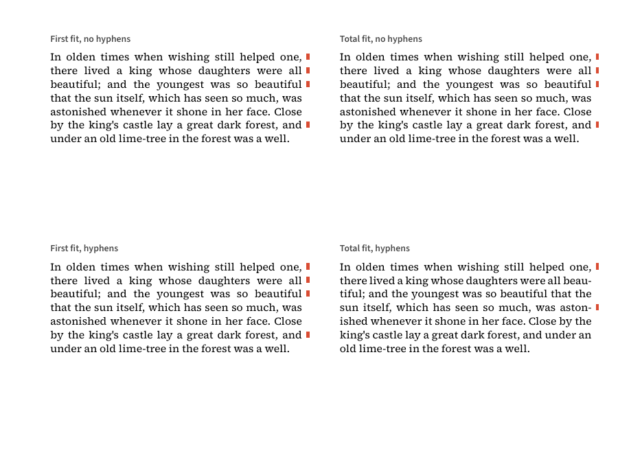

# Typesetting in Tcl

`ztcl::typeset` breaks paragraphs into lines the way a book printer does. It looks at the whole paragraph before it picks a line break, it hyphenates words with the patterns of TeX, and it gives the place of each word. The output is data, so the same paragraph can go into a PDF, a ztk canvas, a terminal, or an SVG image. This guide shows each of these, and explains how the line breaker works. [ztcl::typeset](modules/typeset.md) is the reference of each command.

> [!NOTE]
> `ztcl::typeset` is on `main` and comes in the next release. [Build from source](install.md#build-from-source) to use it now.

## Justified text in a terminal

With no font, `ztcl::typeset justify` breaks the text on a grid of characters. Each line but the last of a paragraph fills the width, and the spaces of a line differ by one character at most:

<!-- run: native -->
```tcl
package require ztcl::typeset
puts -nonewline [ztcl::typeset justify "The line breaker looks at the whole paragraph,\
    so the spaces stay even from one line to the next. A blank line\
    starts a new paragraph." -width 36]
```

```text
The  line breaker looks at the whole
paragraph,  so  the spaces stay even
from  one  line to the next. A blank
line starts a new paragraph.
```

Use it for the help text of a command-line tool, for a README, or for a commit message. `-align left` gives ragged lines with the same breaks.

## First fit and total fit

Most programs break lines with first fit: they put words on a line until the next word does not fit, and then start a new line. Each choice is local, so one long word can leave a line with very wide spaces, and the next line cannot help it. The total-fit algorithm of Knuth and Plass gives each possible line a cost, the badness, from how much its spaces stretch or shrink. It then picks the set of breaks with the lowest total cost for the whole paragraph. A slightly tighter line early can save a very loose line later.

The image below is one paragraph in a column of 240 points, broken four ways by `examples/typeset/compare.tcl`. A red mark is a loose line: its spaces stretch past their limit (a ratio above 1).



On a narrow column with no hyphens, no set of breaks is good, and the two methods are close. With hyphens, total fit finds breaks with even spaces on nearly each line, and first fit still leaves loose lines. Each method gets the same text and the same hyphens: the difference is only the choice of the breaks.

To see the numbers, ask `break` for the ratio of each line. Here the text is on a grid of 34 characters, with no hyphens:

<!-- run: native -->
```tcl
package require ztcl::typeset
set text "In olden times when wishing still helped one, there lived a king\
    whose daughters were all beautiful; and the youngest was so beautiful\
    that the sun itself was astonished whenever it shone in her face."
foreach method {greedy total} {
    set ratios {}
    foreach line [ztcl::typeset break $text -width 34 -method $method -hyphenate 0] {
        lappend ratios [format %.2f [dict get $line ratio]]
    }
    puts "$method: $ratios"
}
```

```text
greedy: 0.20 0.80 3.33 0.00 0.20 0.75 0.00
total: 1.75 0.60 1.25 0.00 0.20 0.75 0.00
```

First fit fills the first two lines well, and then the third line has to stretch its spaces to 3.33 times their limit. Total fit makes the first line a little looser, and no line goes past 1.75.

## Hyphenation

`ztcl::typeset hyphenate` gives the places where a word can break, from the patterns of Liang:

<!-- run: native -->
```tcl
package require ztcl::typeset
foreach word {hyphenation typesetting algorithm paragraph} {
    puts [ztcl::typeset hyphenate $word]
}
```

```text
hy-phen-ation
type-set-ting
al-go-rithm
para-graph
```

A word keeps at least two letters before the first hyphen and three after the last. The line breaker uses a hyphen only when it lowers the total cost: each hyphen has a penalty, and two hyphenated lines in a row cost more. `-hyphenate 0` turns hyphens off.

The patterns are those of American English from the hyph-utf8 package, with a permissive license. [References](references/typeset.md) has the license, and explains why other languages need a check first.

## Words with a font

With `-font` and `-size`, the widths come from a TrueType font, with its kerning and ligatures. Load the bytes of the font file first:

```tcl
package require ztcl::typeset
set f [open book/fonts/SourceSerif4-Regular.ttf rb]
set font [ztcl::typeset font load [read $f]]
close $f
puts [ztcl::typeset font metrics $font 10]
puts [ztcl::typeset font measure $font 10 "office"]
foreach line [ztcl::typeset break $text -width 240 -font $font -size 10] {
    puts "[dict get $line text] ([dict get $line ratio])"
}
```

Each line has `words`, a list of x positions and words. Put each word at its x, and the line is justified.

## A PDF

`ztcl::pdf` draws the words of each line in the same font. The letter of the [PDF guide](pdf.md) has justified, hyphenated paragraphs from this loop:

```tcl
foreach line [ztcl::typeset break $para -width 432 -font $tf -size 11] {
    foreach {x word} [dict get $line words] {
        ztcl::pdf text $doc $page $font 11 [expr {90 + $x}] $y $word
    }
    set y [expr {$y - 15}]
}
```

`ztcl::typeset markdown` goes further: it lays out a whole Markdown document into pages, with headings, code blocks, notes, cross references, an outline, and an index.

## A ztk canvas

In a ztk app, the same lines go on a canvas as text items. The font of the canvas must be the font that `break` measured:

```tcl
package require Tk
canvas .c -width 420 -height 300 -background white
pack .c
set y 30
foreach line [ztcl::typeset break $text -width 380 -font $font -size 11] {
    foreach {x word} [dict get $line words] {
        .c create text [expr {20 + $x}] $y -text $word -anchor sw -font {{Source Serif 4} 11}
    }
    incr y 16
}
```

A canvas has a scale in pixels, and a font size in points. At a scale of 1, give `break` the size in pixels.

## SVG and HTML

`ztcl::typeset svg` gives an SVG image of the paragraph. Each word has its own x, so a browser shows the same breaks as the PDF. Put the image in an HTML page, and give the page the same font with `@font-face`:

```tcl
set svg [ztcl::typeset svg $text -width 400 -font $font -size 12 -family "Source Serif 4"]
```

## Pages and columns

`ztcl::typeset pages` places paragraphs in columns and pages. It gets the line count of each paragraph and keeps a first line or a last line from standing alone at the edge of a column:

<!-- run: native -->
```tcl
package require ztcl::typeset
foreach page [ztcl::typeset pages {4 3 5} -lines 6 -columns 2] {
    puts $page
}
```

```text
{{0 0 4}} {{1 0 3} {2 0 3}}
{{2 3 5}}
```

Each item `{paragraph first end}` puts lines `first` to `end - 1` of the paragraph in the column.

## How the line breaker works

The breaker follows the paper of Knuth and Plass (1981). A paragraph is a list of three kinds of item:

- a *box* is a word or a part of a word, with a fixed width;
- *glue* is a space, with a natural width, a stretch, and a shrink;
- a *penalty* is a place where a line can end, with a cost, and with the width of a hyphen if the line ends there.

A line can end at glue after a box, or at a penalty. For a line from one break to the next, the *adjustment ratio* is the extra width that the line needs, divided by the stretch of its glue (or the shrink, for a line that is too long). The *badness* is 100 times the cube of the ratio, so a line that stretches its spaces to twice their limit is eight times as bad as one at the limit. The *demerits* of a break are the square of the badness plus a line penalty, and the square of the penalty of the break. Two hyphens in a row, and a very tight line next to a very loose one, add more demerits.

The breaker reads the items once. It keeps a list of *active* breaks: the places where a line can start. At each place where a line can end, it computes the demerits of a line from each active break, and keeps the best one. An active break goes out of the list when a line from it is too long. At the end, the path with the fewest total demerits is the result. The work grows with the count of items times the count of active breaks, and the active list stays short, so the work is close to linear in the length of the paragraph.

The breaker of `ztcl::typeset markdown` runs up to four passes: no hyphens and a tolerance of 100, then hyphens and a tolerance of 200, then extra stretch, then any break. It also puts a part of the width of a period, a comma, a hyphen, or a quote at the end of a line into the margin, so the edge of the text looks straight.

## What goes into the PDF

`ztcl::pdf` embeds each font as a subset: the glyphs that the document uses, and the components of their composite glyphs, with the glyph numbers of the font. The file has the widths of these glyphs and a map from each glyph back to its text, so a reader can search and copy the text, ligatures too. The PDF of the sample chapter of the book (`zig build book`, 2026-11-27) has seven pages and subsets of five fonts in 58,860 bytes. The files of these five fonts have 905,056 bytes. PDF/A, for long-term archives, is not in this version.
